# DevOps Micro Internship with Agentic AI — My Journey

> 👋 **New here?** Read the [submission instructions](./onboarding) first — how to fork, fill in, and submit your assignments.
> Find all the required links & assignment guidelines from here [Required links](./dmi_cohort3_resources.md)

---

## About Me

| | |
|---|---|
| **Name** | Busola Helen Awotimide |
| **LinkedIn** | [Busola-Helen-Awotimide](https://www.linkedin.com/in/busola-helen-awotimide/) |
| **Location** | Ibadan, Nigeria |
| **Background** | Cloud, DevOps Engineer |
| **Goal** | Train 10,000+ DevOps professionals |

---

## About the Program

**DevOps Micro Internship with Agentic AI** is a 14-week mentor-led cohort program by [Pravin Mishra](https://www.linkedin.com/in/pravin-mishra-aws-trainer/) — Cloud, DevOps & AI consultant with 15+ years of experience, 5,000+ learners trained, and 26K+ LinkedIn followers.

This is not a course. It is an internship-style program — real deployments, real pipelines, real evidence reviewed by mentors every week.

- 🌐 Program Website: https://dmi.pravinmishra.com?utm_source=github&utm_medium=readme
- 💬 Discord Community: https://discord.pravinmishra.com?utm_source=github&utm_medium=readme
- 📺 YouTube: [Pravin Mishra](https://www.youtube.com/@awswithpravinmishra)
- 🔗 Instructor: [LinkedIn](https://www.linkedin.com/in/pravin-mishra-aws-trainer/)

---

## 🏆 Achievements

### Champion of the Week

<!-- If you were named Champion of the Week, add the badge below and link to your LinkedIn post -->

| Week | Award | Post |
|------|-------|------|
| <!-- e.g. Week 03 --> | <!-- 🏆 Champion of the Week --> | <!-- [LinkedIn Post](#) --> |

### Leaderboard

<!-- Add your cohort leaderboard rank here as you progress -->

> 🥇 Cohort 3 Rank: **#__** <!-- Update this each week -->

---

## My DevOps Stack

*Earn a badge each week. To unlock: remove the `<!--` and `-->` from the badge line below.*

*Share your stack:* `https://github.com/BusolaAwo/devops-micro-internship-pravinmishra.git#my-devops-stack`

**Preview — what your full stack looks like:**

[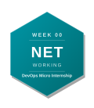](./week-00-internet-and-networking/)[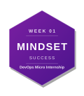](./week-01-success-mindset/)[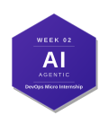](./week-02-agentic-ai/)[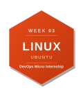](./week-03-linux-and-bash-for-devops/)[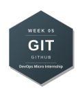](./week-04-git-and-github/)[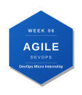](./week-05-devops-lifecycle/)[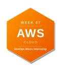](./week-06-aws-cloud/)[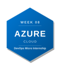](./week-07-azure-cloud/)[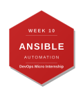](./week-09-ansible/)[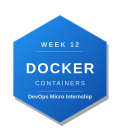](./week-11-docker/)[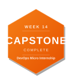](./week-13-final-project/)

---

**Your stack (uncomment each badge as you earn it):**

Week 00 → Internet & Networking Basics 
  

 Week 01 → Success Mindset 
 

Week 02 → Agentic AI with Claude Code 
 

Week 03 → Linux & Bash for DevOps 
 

 Week 04 → Git & GitHub 
 
 Week 04 → Git & GitHub -->
 

Week 05 → DevOps Lifecycle & Agile -->
 

 Week 06 → AWS Cloud 
 

Week 07 → Azure Cloud 
 

 Week 08 → Terraform 

Week 09 → Ansible 
 

 Week 10 → Azure DevOps CI/CD 
  

 Week 11 → Docker 
 

<!-- Week 12 → Kubernetes -->
<!--  -->

<!-- Week 13 → Final Project / Capstone -->
<!--  -->

*Complete a week → uncomment the badge → watch your stack grow.*

---

## Program Overview

| Phase | Weeks | Focus |
|-------|-------|-------|
| Foundation | 00 – 02 | Networking, Mindset, Agentic AI |
| Core DevOps | 03 – 05 | Linux & Bash, Git, DevOps Lifecycle |
| Cloud | 06 – 07 | AWS & Azure Real Deployments |
| Automation | 08 – 10 | Terraform, Ansible, CI/CD |
| Containers | 11 – 12 | Docker & Kubernetes |
| Capstone | 13 | Final Project |

---

## Weekly Progress

| Week | Topic | Status | Assignment | LinkedIn Post | Blog Post |
|------|-------|--------|------------|---------------|-----------|
| 00 | Internet & Networking Basics |✅ Completed | ✅ Completed | https://www.linkedin.com/posts/busola-helen-awotimide_devops-micro-internship-dmi-by-pravin-activity-7447993660673183745-avYM? | https://medium.com/@awsawotimide/im-done-waiting-to-feel-ready-7d57f5fb0792?sharedUserId=awsawotimide
| 01 | Success Mindset | ✅ Completed | ✅ Completed|https://www.linkedin.com/posts/busola-helen-awotimide_trust-me-if-you-love-helping-people-youll-activity-7478306937005121536-n7a7?utm_source=share&utm_medium=member_desktop&rcm=ACoAADtjPKMBDnsQhcIAGnVO4so-PBvk2dEBay4 | https://medium.com/@awsawotimide/reflections-of-whom-im-becoming-08ea7ac35249?sharedUserId=awsawotimide
| 02 | Agentic AI with Claude Code | ✅ Completed | ✅ Completed | https://www.linkedin.com/posts/busola-helen-awotimide_dmibypravinmishra-agenticai-claudecode-ugcPost-7480843782410776576-qGKr | https://medium.com/@awsawotimide/the-week-i-stopped-collecting-ai-tools-and-started-building-system-f64c0419deae |
| 03 | Linux & Bash for DevOps | ✅ Completed | ✅ Completed | https://www.linkedin.com/posts/busola-helen-awotimide_nothing-prepares-you-for-the-moment-you-break-ugcPost-7483280704185966592-vLVa?utm_source=share&utm_medium=member_desktop&rcm=ACoAADtjPKMBDnsQhcIAGnVO4so-PBvk2dEBay4|https://medium.com/@awsawotimide/building-bridges-with-bash-and-ai-my-journey-taming-cloud-pipelines-4530966bf8aa?sharedUserId=awsawotimide|
| 04 | Git & GitHub | ✅ Completed | ✅ Completed |https://www.linkedin.com/posts/busola-helen-awotimide_commit-history-isnt-just-a-record-of-changes-activity-7485452935586500609-1rvj?utm_source=share&utm_medium=member_desktop&rcm=ACoAADtjPKMBDnsQhcIAGnVO4so-PBvk2dEBay4 |https://medium.com/@awsawotimide/mastering-open-source-collaboration-in-my-devops-journey-39c06ebb7c10?sharedUserId=awsawotimide|
| 05 | DevOps Lifecycle & Agile | ✅ Completed | ✅ Completed| https://www.linkedin.com/posts/busola-helen-awotimide_behind-every-feature-you-use-is-a-process-activity-7488091046065709056-t4sA? |https://medium.com/@awsawotimide/replacing-my-portfolio-copy-and-moving-files-the-hard-way-56b47572d608|
| 06 | AWS Cloud | ✅ Completed | ✅ Completed | https://www.linkedin.com/posts/busola-helen-awotimide_i-thought-i-was-done-then-i-audited-what-activity-7495699532010221569-lmnU?utm_source=share&utm_medium=member_desktop&rcm=ACoAADtjPKMBDnsQhcIAGnVO4so-PBvk2dEBay4 |https://medium.com/@awsawotimide/how-i-fixed-my-s3-traps-and-deployed-an-ec2-web-server-on-aws-8292cbc74f6a|
| 07 | Azure Cloud | ✅ Completed |✅ Completed | https://www.linkedin.com/posts/busola-helen-awotimide_a-working-application-can-still-have-a-broken-activity-7495338286949941248-ztny?utm_source=share&utm_medium=member_desktop&rcm=ACoAADtjPKMBDnsQhcIAGnVO4so-PBvk2dEBay4 | https://medium.com/@awsawotimide/what-i-learned-when-my-azure-deployment-completely-broke-and-how-i-fixed-it-c14bd2e68b7d |
| 08 | Terraform | ✅ Completed | ✅ Completed |https://www.linkedin.com/posts/busola-helen-awotimide_your-infrastructure-can-be-working-and-still-activity-7501136454098612224-oOkr?utm_source=share&utm_medium=member_desktop&rcm=ACoAADtjPKMBDnsQhcIAGnVO4so-PBvk2dEBay4| https://medium.com/@awsawotimide/from-refused-connections-to-cloud-resilience-architecting-a-three-tier-next-js-3d950c1c7505|
| 09 | Ansible | ✅ Completed | ✅ Completed |https://www.linkedin.com/posts/busola-helen-awotimide_i-could-have-used-one-tool-i-chose-not-to-activity-7505487027392483329-5wGD?| https://medium.com/@awsawotimide/stop-ssh-ing-into-your-servers-how-i-automated-multi-server-deployments-with-ansible-977b73f88a99|
| 10 | Azure DevOps (CI/CD) | ✅ Completed | ✅ Completed | https://www.linkedin.com/posts/busola-helen-awotimide_theres-a-business-risk-most-companies-don-ugcPost-7508021944848490497-sVVO/? |https://medium.com/@awsawotimide/the-0-deployment-secret-how-i-automated-a-cloud-release-after-my-iac-stack-completely-collapsed-6a952b100f10|
| 11 | Docker |✅ Completed | ✅ Completed |https://www.linkedin.com/posts/busola-helen-awotimide_we-deleted-the-application-something-important-ugcPost-7510921219446190080-ivBO/?utm_source=share&utm_medium=member_desktop&rcm=ACoAADtjPKMBDnsQhcIAGnVO4so-PBvk2dEBay4 |https://medium.com/@awsawotimide/mastering-container-persistence-bind-mounts-vs-docker-volumes-in-action-97c41681b262 |
| 12 | Kubernetes | ✅ Completed | ✅ Completed | https://www.linkedin.com/posts/busola-helen-awotimide_what-if-your-website-stops-working-but-nobody-ugcPost-7518446402335719424-cOUT/?highlightedUpdateUrn=urn%3Ali%3Aactivity%3A7518446405544296448&highlightedUpdateType=SOCIAL_SHARE&origin=SOCIAL_SHARE&utm_source=share&utm_medium=member_android&rcm=ACoAADtjPKMBDnsQhcIAGnVO4so-PBvk2dEBay4|https://medium.com/@awsawotimide/mastering-kubernetes-self-healing-and-clusterip-services-a-hands-on-journey-ac88efd8453c?sharedUserId=awsawotimide |
| 13 | Final Project | ⬜ Not Started | ⏳ Pending | — | — |

**Status:** ⬜ Not Started &nbsp;|&nbsp; 🔄 In Progress &nbsp;|&nbsp; ✅ Completed 
**Assignment:** ⏳ Pending &nbsp;|&nbsp; ✅ Solved

---

## Certificate of Completion

*Awarded upon completing Week 13 — Final Project.*

<!-- Drop your certificate image here -->

---

## Connect

If you found this repo useful or want to follow my DevOps journey:

- ⭐ Star this repo
- 🔗 Connect with me on [LinkedIn](#)
- 🌐 Learn more about the program: https://dmi.pravinmishra.com?utm_source=github&utm_medium=readme
- 💬 Join the community: https://discord.pravinmishra.com?utm_source=github&utm_medium=readme

